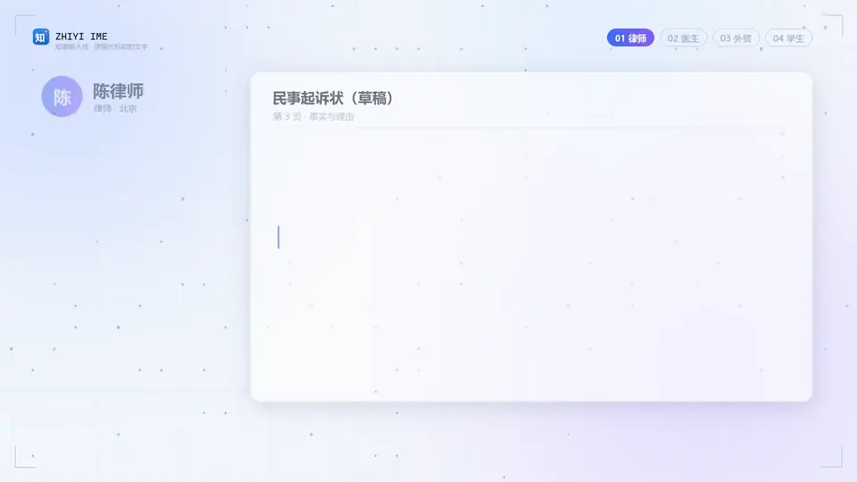
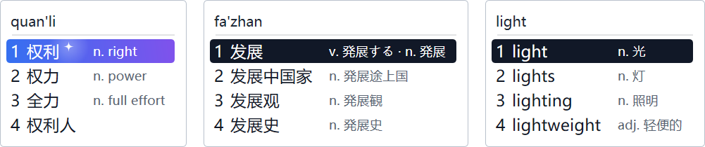
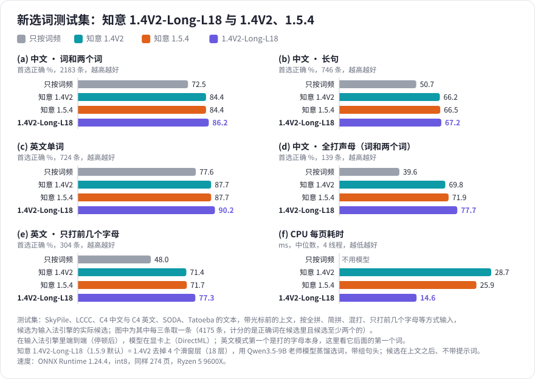
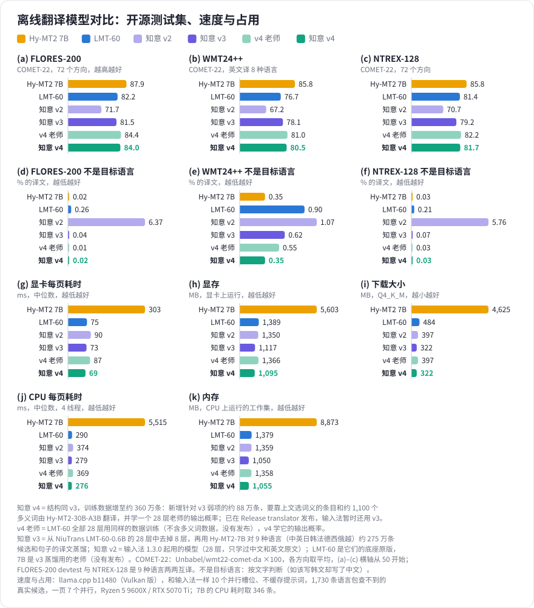

# 知意输入法（Zhiyi IME）

[English](README_EN.md) | **中文**

> 轻量 · 开源 · 懂上文 —— 根据光标前的文字推荐候选的 Windows 中英文输入法

<a href="docs/media/zhiyi-intro.mp4">▶ 观看宣传视频：四个人，四段前文（1 分 58 秒 · 中文配音 · 中英字幕）</a>

## 功能简介

- **懂上文的推荐**：一个在本机运行的小模型读取输入框里光标前的文字，从候选里挑出最可能的那个放在第一位，
  并用蓝紫色星标标出（如“权利 / 权力 / 全力”）。模型不联网，输入内容不会离开你的电脑；有独立显卡时可以
  在设置里改用显卡推理（DirectML，N 卡、A 卡、Intel 显卡都可以，先测速、比 CPU 快才使用）
- **学习模式（候选翻译）**：每个候选后面显示它的外语意思，前面标英文词性（n. v. adj. …），最多三个常用义项，
  打字时顺便学外语。中文候选可以翻成英、日、韩、法、德、西、俄语，英文候选可以翻成中、日、韩、法、德、西、俄语；
  多音字按读音分别翻译。翻译来自离线语言包（中文约 4 万词、英文约 2 万词），只在本机查表。安装包自带中 → 英、
  英 → 中，其余在设置的“学习”页按需下载。词表公开在 [zhiyi-glossary](https://github.com/dd1000001000/zhiyi-glossary)，
  欢迎纠错。词表里没有的词组、生僻词和短句，可以下载本机翻译模型（从腾讯 Hy-MT2-7B 蒸馏，约 0.3 GB）翻译，
  显卡或 CPU 都能运行（CPU 上一页约 0.3 秒），一页的词同时翻、随后补上，不联网。
  打字时按住 Ctrl 再按 1～9，打出的是那个候选的翻译（第一个意思）而不是候选本身，如 `xianzai` 按 Ctrl+1
  打出 `now`；没有翻译的候选不打字
- **数据位置可选**：词库、学习记录、语言包、模型缓存和下载的模型都可以放到别的盘，在“常规”页一键移动
- **全拼、首字母、五笔、双拼**：全拼也认首字母简拼和二者混合（`wsyige` → 我是一个）；首字母模式下
  每个字母对应一个字（`zgr` → 中国人）；双拼可选微软、小鹤、自然码、搜狗、智能ABC五种方案，与全拼共用词库和
  学习记录。打字时按“输入方式切换”键（默认 Ctrl+Space）在四种方式间循环，输入框显示的始终是实际按下的键
- **模糊音**：z=zh、c=ch、s=sh、n=l、an=ang、en=eng、in=ing 可以逐组开关，模糊匹配的词会标出正确拼音
- **英文输入**：单词联想（打几个字母就给出补全）或逐字母输入；打错时给出正确拼写，但不会自动替换
- **中英混输**：中文模式下打出完整的英文单词，该词会出现在候选里
- **自由设置切换键**：中英切换、输入方式、中英文标点、全角/半角都可以设置成自己习惯的按键，
  并提示与系统或其他程序快捷键的冲突
- **任务栏快速切换**：右键任务栏上的“中/英”可以切换中英文、全拼/首字母/五笔/双拼、标点、全角等，
  也可以“退出”后台服务（再次切换到知意输入法时自动启动）
- **候选窗口**：竖排（默认）或横排，浅色 / 深色主题，三档字号；中英文界面
- **自学习**：常用的词自动往前排，刚上屏就按退格可以撤销这次学习
- **备份与迁移**：把所有设置、词库和学习记录导出成一个文件，换电脑或重装后导入；备份不完整或损坏时什么都不导入
- **开机启动可选**：可以不在开机时启动后台服务，第一次切换到知意输入法时再启动
- **自动更新**：打开设置时检查新版本，一键下载、校验并安装；语言包也能单独检查更新
- **隐私**：可选的用户体验改进计划，默认关闭，记录只保存在本机，详见[隐私说明](docs/privacy.md)

## 新选词测试集与知意 1.4V2-Long-L12

新做的选词测试集更接近实际打字：文本来自 SkyPile、LCCC 对话、C4 中英文、SODA 对话和 Tatoeba，带光标前的上文，按全拼、简拼、全拼和声母混打、英文只打前几个字母等方式输入，候选是输入法引擎的实际候选。1.5.9–1.5.11 的默认模型知意 1.4V2-Long-L18（[Release model-zhen-long-l18](https://github.com/dd1000001000/zhiyi_ime/releases/tag/model-zhen-long-l18)，GPL-3.0-only）是 1.4V2 去掉 4 个滑窗注意力层（22 层 → 18 层），用微调过的 Qwen3.5-9B 老师模型（Apache-2.0）在约 170 万条这样的数据上蒸馏选词：候选放在上文之后，不再带提示词，候选只写一次，所以每页要算的词元少了约四成；组句头沿用 1.4V2 的结构，和编码器一起训练。在输入法引擎里端到端（停顿后），它比 1.4V2 和 1.5.4 的首选正确率高：中文词和两个词 86.2%（1.4V2 / 1.5.4 都是 84.4%），长句 67.2%（66.2% / 66.5%），英文 90.2%（87.7%），全打声母 77.7%（69.8% / 71.9%），英文只打前几个字母 77.3%（71.4% / 71.7%）；CPU 上一页 14.6 ms，约为 1.4V2 的一半。旧测试集上的长句和 1.5.4 基本持平（全拼 61.8%，末字只打声母 30.6%，前面简拼、后面全拼 16.5%），输入法实际候选 77.6%（1.5.4 为 78.5%）。同一模型去掉组句头、只留选词头的版本是知意 1.4V2-Sim-L18（[Release model-zhen-sim-l18](https://github.com/dd1000001000/zhiyi_ime/releases/tag/model-zhen-sim-l18)，含 safetensors 版），给自己组句的输入法用：选词和 Long-L18 持平（图中最后一行：中文词和两个词 86.3%，英文 90.5%，全打声母 77.0%，英文只打前几个字母 78.0%，CPU 上一页 12.1 ms），在知意里长句不再由模型组句（长句 62.2%）。

ng1017+1.4V2-Long-L18 在 1.4V2-Long-L18 上加了一个词语 n-gram（三元语言模型）：底座是[幽默输入法](https://github.com/Sraw/youmo-ime)的拼音语言模型（[libime](https://github.com/fcitx/libime) 的模型混入 FineWeb-2 和 Common Crawl 的口语网页），用幽默的工具再混入约 1 亿字的科研文本（[CSL](https://github.com/ydli-ai/CSL) 论文摘要，以及 SkyPile、C4、FineWeb-2 里的科技页面），按相对熵剪枝到二元、三元各 400 万条（79 MB）。选词时每个整句候选加上它给的 ln P（权重在开发集上调），没有上文时也用模型和 n-gram 选词；组句头组出的长句也经过选词头排序（以前组句的第一句直接放在首位）。在输入法引擎里端到端：中文词和两个词 86.2% → 87.6%，长句 67.2% → 74.5%，英文、全打声母和英文只打前几个字母不变；旧测试集的长句全拼 61.8% → 69.0%，末字只打声母 30.6% → 36.6%，前面简拼、后面全拼 16.5% → 21.9%。代价：CPU 上没有上文的页要多算一次模型（中位数约 2 → 11 ms），长句页多一次选词（约 +10 ms），n-gram 文件 79 MB（映射，不读进内存）。

知意 1.4V2-Long-L12（[Release model-zhen-long-l12](https://github.com/dd1000001000/zhiyi_ime/releases/tag/model-zhen-long-l12)，GPL-3.0-only，含 safetensors 版）是 1.5.12 起的默认模型，1.4V2 只保留 12 层编码器（22 层 → 12 层）的新模型。选词用微调过的 Qwen3.5-9B 老师在约 377 万条数据上蒸馏：1.4V2-Long-L18 的约 170 万条之外，新加约 172 万条 SkyPile、LCCC、C4、SODA 的文本，和约 35 万条 [FineWeb](https://huggingface.co/datasets/HuggingFaceFW/fineweb)、[FineWeb-2](https://huggingface.co/datasets/HuggingFaceFW/fineweb-2)（ODC-By 1.0）的近年网页，中英文约 3:1。组句头由另一个微调过、按字写出所打汉字的 Qwen3.5-9B 老师蒸馏，用了约 431 万条组句数据，其中 220 万条带老师打分。加上 ng1017 后在输入法引擎里端到端（图中最后一行），它和 ng1017+1.4V2-Long-L18 打平：中文词和两个词 87.7%（87.6%），长句 74.9%（74.5%），英文 89.5%（90.2%），全打声母 76.3%（77.7%），英文只打前几个字母 75.7%（77.3%），差别都在抽样误差之内；CPU 上一页 10.4 ms（14.7 ms），快约三成，模型文件 84 MB（96 MB）。1.5.12 起输入法带的就是 ng1017+1.4V2-Long-L12。

## 离线翻译模型

学习模式里语言包查不到的候选由本机的翻译模型翻译，现在用的是知意 v3：从 [LMT-60-0.6B](https://huggingface.co/NiuTrans/LMT-60-0.6B) 的 28 层中去掉 8 层，用腾讯 [Hy-MT2-7B](https://huggingface.co/tencent/Hy-MT2-7B) 对约 275 万条输入法候选和句子（中、英、日、韩、法、德、西、俄、越 9 种语言，带光标前的上文）的译文蒸馏而来。在三个开源测试集上，COMET-22 比之前用的知意 v2 高 8–11 分，和 LMT-60 原版相近（FLORES-200、NTREX-128 低 1–2 分，WMT24++ 高 1.4 分）；输出不是目标语言的比例在 FLORES-200 和 NTREX-128 上从 v2 的约 6% 降到 0.1% 以下。下载约 0.32 GB（v2 约 0.4 GB），显卡上一页约 70 毫秒、CPU 上一页约 0.3 秒，都比 v2 快，显存和内存也更少。

## 安装说明

**系统要求**：Windows 10 / 11（64 位）。

1. 从 [Releases](https://github.com/dd1000001000/zhiyi_ime/releases/latest) 下载最新的
   `zhiyi-v版本号-setup.exe`，双击运行并按提示安装（需要管理员权限）。
2. 安装完成后按 `Win + 空格` 切换到“知意输入法”。也可以在“设置 > 时间和语言 > 语言和区域”中
   把它设为默认输入法。
3. 打开设置：右键任务栏上的“中/英”，选择“设置…”。

- **更新**：有新版本时，打开设置会提醒你，在“更新”页点“立即更新”即可。已经打开的程序要重新打开
  才会用上新版本。
- **换电脑或重装**：在设置的“词库”页“导出…”备份，到新电脑上“导入…”。
- **卸载**：在“设置 > 应用 > 已安装的应用”中卸载“知意输入法”，可以选择是否保留个人数据
  （位于 `%USERPROFILE%\zhiyi\`，包括设置、学习记录和下载的语言包）。

## 致谢

知意输入法基于 [CxxIME](https://github.com/deanxyuan/cxx-ime) 修改而来，感谢以下项目：

- [CxxIME](https://github.com/deanxyuan/cxx-ime)：输入法框架、拼音引擎、候选窗与设置程序（Apache License 2.0）
- [rime-ice（雾凇拼音）](https://github.com/iDvel/rime-ice)：中文拼音词库与英文词表（GPL-3.0）
- [Laya](https://huggingface.co/convaiinnovations/laya)：上文推荐模型的结构与蒸馏用的老师模型（Apache-2.0）
- [mmBERT](https://huggingface.co/jhu-clsp/mmBERT-small)：上文推荐模型的编码器 mmBERT-small（MIT）
- [LMT-60](https://huggingface.co/NiuTrans/LMT-60-0.6B)（NiuTrans）：离线翻译模型的底座（Apache-2.0）
- [Hy-MT2](https://huggingface.co/tencent/Hy-MT2-7B)（腾讯混元）：离线翻译的第 1 版模型（1.8B）和蒸馏用的老师模型（7B）（Apache-2.0）
- [Qwen3.5-9B](https://huggingface.co/Qwen/Qwen3.5-9B)（通义千问）：知意 1.4V2-Long-L18 / Sim-L18 / Long-L12 选词和 Long-L12 组句头蒸馏用的老师模型，经 LoRA 微调（Apache-2.0）
- [幽默输入法](https://github.com/Sraw/youmo-ime)：词语 n-gram 的底座（它的拼音语言模型）和混合用的工具（LGPL-2.1-or-later）；其底座来自 [libime](https://github.com/fcitx/libime)（LGPL-2.1-or-later），混入的网页来自 [FineWeb-2](https://huggingface.co/datasets/HuggingFaceFW/fineweb-2)（ODC-By）和 [Common Crawl](https://commoncrawl.org)
- [CSL](https://github.com/ydli-ai/CSL)（中文科学文献数据集，Apache-2.0）：词语 n-gram 混入的科研文本
- [llama.cpp](https://github.com/ggml-org/llama.cpp)：离线翻译模型的运行库（MIT，随模型下载）
- [LCCC](https://github.com/thu-coai/CDial-GPT)（MIT）与 [C4](https://huggingface.co/datasets/allenai/c4) 中文部分（ODC-BY）：模型蒸馏的部分语料
- [Tatoeba](https://tatoeba.org)（CC BY 2.0 FR）与 [C4](https://huggingface.co/datasets/allenai/c4) 的英、日、韩、法、德、西、俄、越文部分（ODC-BY）：离线翻译模型 v3 的外语原文
- [SkyPile-150B](https://huggingface.co/datasets/Skywork/SkyPile-150B)（昆仑万维天工 Skywork，Skywork Community License）：1.5.4 起长拼音组句部分的训练文本（约七成），离线翻译模型 v3 的中文句子，以及 1.4V2-Long-L18 / Sim-L18 / Long-L12 选词数据和 Long-L12 组句数据的一部分
- [SODA](https://huggingface.co/datasets/allenai/soda)（CC BY 4.0）、Tatoeba 与 C4 英文部分：1.4V2-Long-L18 / Sim-L18 / Long-L12 英文选词数据的文本
- [FineWeb](https://huggingface.co/datasets/HuggingFaceFW/fineweb) 与 [FineWeb-2](https://huggingface.co/datasets/HuggingFaceFW/fineweb-2)（ODC-By 1.0）：1.4V2-Long-L12 选词数据里的近年网页
- [wordfreq](https://github.com/rspeer/wordfreq)：英文词频（CC BY-SA 4.0）
- [ONNX Runtime](https://github.com/microsoft/onnxruntime)：模型推理（MIT）
- [DirectML](https://github.com/microsoft/DirectML)：显卡推理（微软 DirectML 许可，可再分发）

学习模式的语言包由大语言模型（GLM、Gemma）离线生成后经自动检查和人工修订，词表按 GPL-3.0 公开在
[zhiyi-glossary](https://github.com/dd1000001000/zhiyi-glossary)。

知意输入法按 [GPL-3.0-only](LICENSE) 发布。知意自己训练的模型（上文推荐模型、离线翻译模型 v2、v3）同样按 GPL-3.0-only 发布；语音模型（SenseVoice-Small、Silero VAD）和 llama.cpp 运行库不是知意训练的，保持各自的许可，许可证随下载附带。各组件的完整声明见 [NOTICE](NOTICE) 和
[THIRD_PARTY_NOTICES.txt](THIRD_PARTY_NOTICES.txt)。开发与构建说明见 [docs/development.md](docs/development.md)。
