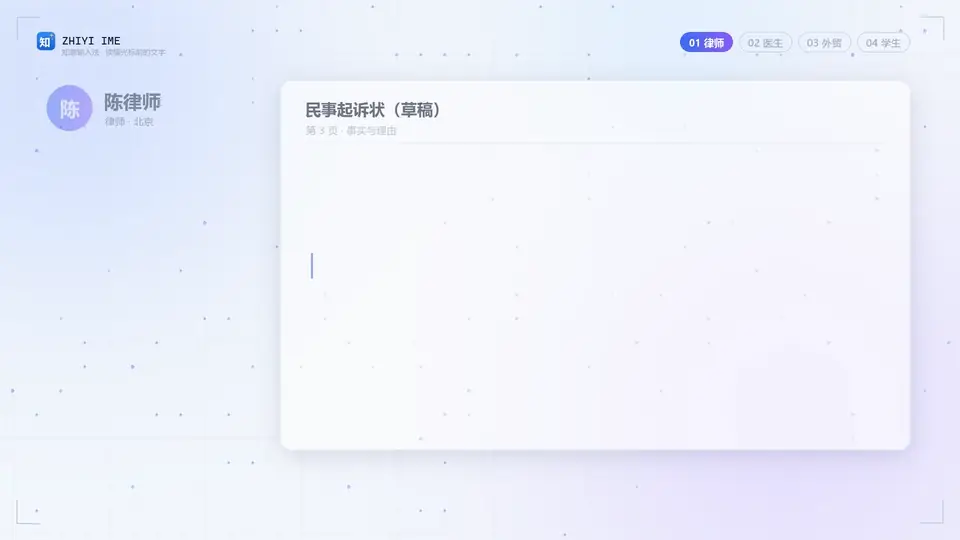
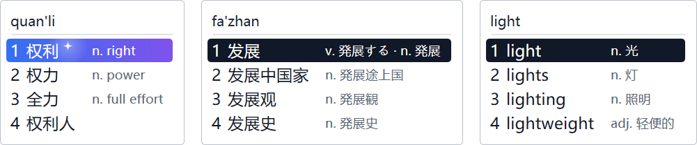

# 知意输入法（Zhiyi IME）

[English](README_EN.md) | **中文**

> 轻量 · 开源 · 懂上文 —— 根据光标前的文字推荐候选的 Windows 中英文输入法

<a href="docs/media/zhiyi-intro.mp4">▶ 观看宣传视频：四个人，四段前文（1 分 58 秒 · 中文配音 · 中英字幕）</a>

## 功能简介

- **懂上文的推荐**：一个在本机运行的小模型读取输入框里光标前的文字，从候选里挑出最可能的那个放在第一位，
  并用蓝紫色星标标出（如“权利 / 权力 / 全力”）。模型在 CPU 上运行，不联网，输入内容不会离开你的电脑
- **学习模式（候选翻译）**：每个候选后面显示它的外语意思，前面标英文词性（n. v. adj. …），最多三个常用义项，
  打字时顺便学外语。中文候选可以翻成英、日、韩、法、德、西、俄语，英文候选可以翻成中、日、韩、法、德、西、俄语；
  多音字按读音分别翻译。翻译来自离线语言包（中文约 4 万词、英文约 2 万词），只在本机查表。安装包自带中 → 英、
  英 → 中，其余在设置的“学习”页按需下载。词表公开在 [zhiyi-glossary](https://github.com/dd1000001000/zhiyi-glossary)，
  欢迎纠错。词表里没有的词组、生僻词和短句，可以下载本机翻译模型（从腾讯 Hy-MT2-7B 蒸馏，约 0.3 GB）翻译，
  显卡或 CPU 都能运行（CPU 上一页约 0.3 秒），一页的词同时翻、随后补上，不联网。
  打字时按住 Ctrl 再按 1～9，打出的是那个候选的翻译（第一个意思）而不是候选本身，如 `xianzai` 按 Ctrl+1
  打出 `now`；没有翻译的候选不打字
- **数据位置可选**：词库、学习记录、语言包、模型缓存和下载的模型都可以放到别的盘，在“常规”页一键移动
- **全拼、首字母、五笔、双拼**：全拼也认首字母简拼和二者混合（`wsyige` → 我是一个）；首字母模式下
  每个字母对应一个字（`zgr` → 中国人）；双拼可选微软、小鹤、自然码、搜狗、智能ABC五种方案，与全拼共用词库和
  学习记录。打字时按“输入方式切换”键（默认 Ctrl+Space）在四种方式间循环，输入框显示的始终是实际按下的键
- **模糊音**：z=zh、c=ch、s=sh、n=l、an=ang、en=eng、in=ing 可以逐组开关，模糊匹配的词会标出正确拼音
- **英文输入**：单词联想（打几个字母就给出补全）或逐字母输入；打错时给出正确拼写，但不会自动替换
- **中英混输**：中文模式下打出完整的英文单词，该词会出现在候选里
- **自由设置切换键**：中英切换、输入方式、中英文标点、全角/半角、语音输入都可以设置成自己习惯的按键，
  轻按 Shift、Ctrl、Alt 都行，可分左右；并提示与系统或其他程序快捷键的冲突
- **快捷短语**：打编码在指定位置出事先写好的短语（`dh` 出手机号），格式同搜狗，可导入导出；
  拼音读作“日期”“时间”“星期”时出当前日期时间，见[快捷短语](docs/custom-phrases.md)
- **U 模式和 V 模式**：和微软拼音一样，`v` 开头输入中文数字、大写金额、日期（含农历）、时间、算式；
  `u` 开头按笔画或部件读音输入不认识的字，见[U 模式和 V 模式](docs/uv-mode.md)
- **自定义标点**：像搜狗一样在表格里设置每个符号键在中文标点下打出什么，半角、全角分开，可以成对，
  见[自定义标点](docs/punctuation.md)
- **任务栏快速切换**：右键任务栏上的“中/英”可以切换中英文、全拼/首字母/五笔/双拼、标点、全角等，
  也可以“退出”后台服务（再次切换到知意输入法时自动启动）
- **候选窗口**：竖排（默认）或横排，浅色 / 深色主题，三档字号；中英文界面
- **自学习**：常用的词自动往前排，刚上屏就按退格可以撤销这次学习
- **备份与迁移**：把所有设置、词库和学习记录导出成一个文件，换电脑或重装后导入；备份不完整或损坏时什么都不导入
- **开机启动可选**：可以不在开机时启动后台服务，第一次切换到知意输入法时再启动
- **自动更新**：打开设置时检查新版本，一键下载、校验并安装；语言包也能单独检查更新
- **隐私**：可选的用户体验改进计划，默认关闭，记录只保存在本机，详见[隐私说明](docs/privacy.md)

## 模型

上文推荐的选词模型、词语 n-gram 和离线翻译模型都是知意自己训练的，放在单独的仓库
[zhiyi_models](https://github.com/dd1000001000/zhiyi_models)：各版模型的结构、训练数据、评测结果和下载都在那里。输入法现在带的是选词模型
ML-Flash-1103 和词语 n-gram ng1017；学习模式的离线翻译用 v4-1026，在设置的“学习”页下载。

## 安装说明

**系统要求**：Windows 10 / 11（64 位）。

1. 从 [Releases](https://github.com/dd1000001000/zhiyi_ime/releases/latest) 下载最新的
   `zhiyi-v版本号-setup.exe`，双击运行并按提示安装（需要管理员权限）。
2. 安装完成后按 `Win + 空格` 切换到“知意输入法”。也可以在“设置 > 时间和语言 > 语言和区域”中
   把它设为默认输入法。
3. 打开设置：右键任务栏上的“中/英”，选择“设置…”。

- **更新**：有新版本时，打开设置会提醒你，在“更新”页点“立即更新”即可。已经打开的程序要重新打开
  才会用上新版本。
- **换电脑或重装**：在设置的“词库”页“导出…”备份，到新电脑上“导入…”。
- **卸载**：在“设置 > 应用 > 已安装的应用”中卸载“知意输入法”，可以选择是否保留个人数据
  （位于 `%USERPROFILE%\zhiyi\`，包括设置、学习记录和下载的语言包）。

## 致谢

知意输入法基于 [CxxIME](https://github.com/deanxyuan/cxx-ime) 修改而来，感谢以下项目：

- [CxxIME](https://github.com/deanxyuan/cxx-ime)：输入法框架、拼音引擎、候选窗与设置程序（Apache License 2.0）
- [rime-ice（雾凇拼音）](https://github.com/iDvel/rime-ice)：中文拼音词库与英文词表（GPL-3.0）
- [Laya](https://huggingface.co/convaiinnovations/laya)：上文推荐模型的结构与蒸馏用的老师模型（Apache-2.0）
- [mmBERT](https://huggingface.co/jhu-clsp/mmBERT-small)：上文推荐模型的编码器 mmBERT-small（MIT）
- [LMT-60](https://huggingface.co/NiuTrans/LMT-60-0.6B)（NiuTrans）：离线翻译模型的底座（Apache-2.0）
- [Hy-MT2](https://huggingface.co/tencent/Hy-MT2-7B)（腾讯混元）：离线翻译的第 1 版模型（1.8B）和蒸馏用的老师模型（7B，v4 起还有 [30B-A3B](https://huggingface.co/tencent/Hy-MT2-30B-A3B)）（Apache-2.0）
- [Qwen3.5-9B](https://huggingface.co/Qwen/Qwen3.5-9B)（通义千问）：知意 1.4V2-Long-L18 / Long-L12 / ML-pumpkin-1026 / ML-Flash-1031 / ML-Flash-1103 选词和 Long-L12 / ML-pumpkin-1026 / ML-Flash-1031 / ML-Flash-1103 组句头蒸馏用的老师模型，经 LoRA 微调（Apache-2.0）
- [幽默输入法](https://github.com/Sraw/youmo-ime)：词语 n-gram 的底座（它的拼音语言模型）和混合用的工具（LGPL-2.1-or-later）；其底座来自 [libime](https://github.com/fcitx/libime)（LGPL-2.1-or-later），混入的网页来自 [FineWeb-2](https://huggingface.co/datasets/HuggingFaceFW/fineweb-2)（ODC-By）和 [Common Crawl](https://commoncrawl.org)
- [CSL](https://github.com/ydli-ai/CSL)（中文科学文献数据集，Apache-2.0）：词语 n-gram 混入的科研文本
- [rime-stroke（五笔画）](https://github.com/rime/rime-stroke)（LGPL-3.0）、开放词典网的[汉语拆字字典](https://github.com/kfcd/chaizi)（CC BY 3.0）、[pinyin-data](https://github.com/mozillazg/pinyin-data)（MIT）：U 模式的笔画、拆字和读音
- [llama.cpp](https://github.com/ggml-org/llama.cpp)：离线翻译模型的运行库（MIT，随模型下载）
- [LCCC](https://github.com/thu-coai/CDial-GPT)（MIT）与 [C4](https://huggingface.co/datasets/allenai/c4) 中文部分（ODC-BY）：模型蒸馏的部分语料
- [Tatoeba](https://tatoeba.org)（CC BY 2.0 FR）与 [C4](https://huggingface.co/datasets/allenai/c4) 的英、日、韩、法、德、西、俄、越文部分（ODC-BY）：离线翻译模型 v3 的外语原文
- [SkyPile-150B](https://huggingface.co/datasets/Skywork/SkyPile-150B)（昆仑万维天工 Skywork，Skywork Community License）：1.5.4 起长拼音组句部分的训练文本（约七成），离线翻译模型 v3 的中文句子，以及 1.4V2-Long-L18 / Long-L12 选词数据和 Long-L12 组句数据的一部分
- [SODA](https://huggingface.co/datasets/allenai/soda)（CC BY 4.0）、Tatoeba 与 C4 英文部分：1.4V2-Long-L18 / Long-L12 英文选词数据的文本
- [FineWeb](https://huggingface.co/datasets/HuggingFaceFW/fineweb) 与 [FineWeb-2](https://huggingface.co/datasets/HuggingFaceFW/fineweb-2)（ODC-By 1.0）：1.4V2-Long-L12 选词数据里的近年网页，ML-pumpkin-1026 繁体中文、粤语、日文、韩文、越南文的文本
- [粤语维基百科](https://zh-yue.wikipedia.org)（CC BY-SA 4.0）：ML-pumpkin-1026 粤拼组句的部分文本
- [wordfreq](https://github.com/rspeer/wordfreq)：英文词频（CC BY-SA 4.0）
- [ONNX Runtime](https://github.com/microsoft/onnxruntime)：模型推理（MIT）
- [DirectML](https://github.com/microsoft/DirectML)：语音识别的显卡推理（微软 DirectML 许可，可再分发）

学习模式的语言包由大语言模型（GLM、Gemma）离线生成后经自动检查和人工修订，词表按 GPL-3.0 公开在
[zhiyi-glossary](https://github.com/dd1000001000/zhiyi-glossary)。

知意输入法按 [GPL-3.0-only](LICENSE) 发布。知意自己训练的模型（各版上文推荐模型、离线翻译模型 v2、v3、v4）的权重按 [Apache-2.0](data/licenses/Apache-2.0.txt) 发布（2026-10-20 前为 GPL-3.0-only）；词语 n-gram ng1017 随其底座按 [LGPL-2.1-or-later](data/licenses/LGPL-2.1.txt) 发布；语音模型（SenseVoice-Small、Silero VAD）和 llama.cpp 运行库不是知意训练的，保持各自的许可，许可证随下载附带。各组件的完整声明见 [NOTICE](NOTICE) 和
[THIRD_PARTY_NOTICES.txt](THIRD_PARTY_NOTICES.txt)。开发与构建说明见 [docs/development.md](docs/development.md)。
