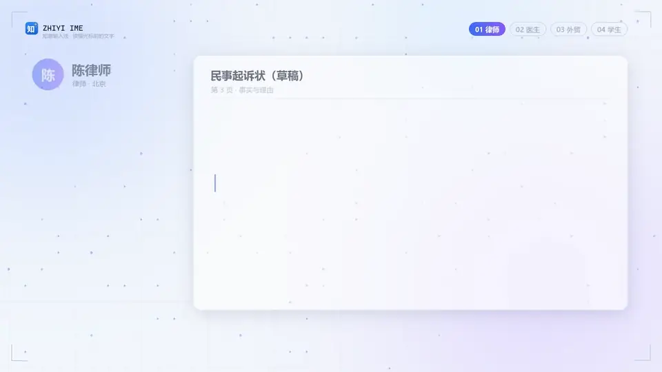
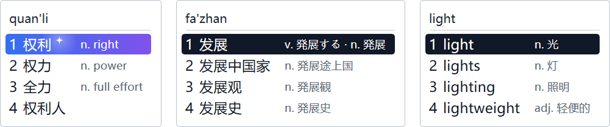

# Zhiyi IME (知意输入法)

**English** | [中文](README.md)

> Lightweight · Open source · Context-aware — a Windows Chinese/English input method that picks
> candidates by the text before the caret

<a href="docs/media/zhiyi-intro.mp4">▶ Watch the intro video: four people, four stories (1:58 · Chinese voices · Chinese and English subtitles)</a>

## Features

- **Context-aware recommendation**: a small model running on your computer reads the text before
  the caret, puts the most likely candidate first and marks it with a blue-purple star (权利 / 权力 /
  全力). The model works offline; nothing you type leaves your computer. With a dedicated graphics
  card the model can run on it instead (DirectML: NVIDIA, AMD and Intel cards; Settings tests the
  speed first and uses the card only when it is faster than the CPU).
- **Learning mode (candidate translations)**: each candidate shows what it means in another language,
  with English part-of-speech labels (n. v. adj. …) and up to three common senses, so you pick up a
  language while typing. Chinese candidates can be shown in English, Japanese, Korean, French,
  German, Spanish or Russian, English candidates in Chinese, Japanese, Korean, French, German, Spanish
  or Russian; words with several readings are translated by reading. Translations come from offline
  language packs (about 40,000 Chinese and 20,000 English words) looked up on your computer. The
  installer includes Chinese → English and English → Chinese; the others are downloaded on the
  Learning page in Settings. The word lists are open at
  [zhiyi-glossary](https://github.com/dd1000001000/zhiyi-glossary): corrections welcome. Phrases,
  rare words and short sentences the packs lack can be translated by a downloadable on-device model
  (about 0.3 GB, distilled from Tencent Hy-MT2-7B) on a graphics card or the CPU (about 0.3 s a page
  on the CPU): a page at once, filled in as it arrives, offline. While typing, hold Ctrl and press
  1-9 to type that candidate's translation (its first sense) instead of the candidate: `xianzai`
  then Ctrl+1 types `now`; a candidate without a translation types nothing.
- **Choose where data lives**: the user dictionary, learning records, language packs, model caches
  and downloaded models can move to another drive with one click on the General page.
- **Full pinyin, initials, Wubi, shuangpin**: full pinyin also accepts initials and a mix of both
  (`wsyige` → 我是一个); in initials mode each letter is one character (`zgr` → 中国人); shuangpin
  comes in the Microsoft, Xiaohe, Ziranma, Sogou and Smart ABC schemes and shares the dictionary
  and learning records with full pinyin. While typing, the style switch key (Ctrl+Space by default) cycles the
  four; the input box always shows the keys as typed.
- **Fuzzy pinyin**: z=zh, c=ch, s=sh, n=l, an=ang, en=eng, in=ing, each pair on or off; words found
  through a fuzzy pair show their correct pinyin.
- **English input**: word completion or letter by letter; misspelled words get their correct spelling
  as a candidate, never replaced automatically.
- **Mixed input**: a complete English word typed in Chinese mode is offered among the candidates.
- **Your own switch keys** for Chinese/English, input style, punctuation, full/half width and voice input,
  including a tapped Shift, Ctrl or Alt (left, right or either), with warnings about conflicts with Windows
  or other programs.
- **Custom phrases**: a code brings up a prepared phrase at a chosen place (`dh` for a phone number), in
  Sogou's format, with import and export; pinyin read as 日期 / 时间 / 星期 gives the current date and time
  ([details](docs/custom-phrases.md)).
- **U mode and V mode**, as in Microsoft Pinyin: `v` first types numbers in Chinese, amounts in capitals,
  dates (with the lunar date), times and formulas; `u` first finds a character by its strokes or the readings
  of its parts ([details](docs/uv-mode.md)).
- **Custom punctuation**: a table, as in Sogou Pinyin, of what each symbol key types with Chinese punctuation,
  at half and full width, pairs included ([details](docs/punctuation.md)).
- **Taskbar menu**: right-click the 中/英 indicator to switch Chinese/English, full pinyin / initials /
  Wubi / shuangpin, punctuation, full width and more, or to exit the background service (it starts again when you
  switch to Zhiyi IME).
- **Candidate window**: vertical (default) or horizontal, light and dark themes, three font sizes;
  Chinese and English interface.
- **Self-learning**: words you use move up; Backspace right after a commit undoes what it learned.
- **Backup and transfer**: export all settings, the lexicon and the learning records to one file and
  import it on another computer or after reinstalling; nothing is imported from an incomplete or
  damaged backup.
- **Optional start at sign-in**: the background service can start the first time you switch to
  Zhiyi IME instead.
- **Automatic updates**: Settings checks for a new version when it opens and installs it in one click;
  language packs have their own update check.
- **Privacy**: an optional user experience program, off by default, with records kept on your computer
  only; see the [privacy notes](docs/privacy.en.md).

## Models

The word-choice models, word n-grams and offline translation models are Zhiyi's own and live in a repository of their
own, [zhiyi_models](https://github.com/dd1000001000/zhiyi_models), with their structure, training data, results and downloads. The IME ships the
word-choice model ML-pumpkin-1026 and the word n-gram ng1017; learning mode's offline translation uses v4-1026,
downloaded on the Learning page of Settings.

## Installation

**Requirements**: Windows 10 / 11 (64-bit).

1. Download the latest `zhiyi-v<version>-setup.exe` from
   [Releases](https://github.com/dd1000001000/zhiyi_ime/releases/latest) and run it (administrator
   approval is needed).
2. Press `Win + Space` to switch to Zhiyi IME, or make it the default input method in Windows Settings
   > Time & language > Language & region.
3. To open Settings, right-click 中/英 on the taskbar and choose Settings….

- **Updates**: when a new version is out, Settings tells you; click Update now on its Updates page.
  Programs already open use the new version after they are reopened.
- **Moving to another computer or reinstalling**: Export… on the Dictionary page of Settings, then
  Import… on the new computer.
- **Uninstalling**: uninstall Zhiyi IME in Windows Settings > Apps > Installed apps; you can keep your
  personal data (settings, learned words and downloaded language packs in `%USERPROFILE%\zhiyi\`).

## Credits

Zhiyi IME is a modified version of [CxxIME](https://github.com/deanxyuan/cxx-ime). Thanks to:

- [CxxIME](https://github.com/deanxyuan/cxx-ime): the input method framework, pinyin engine,
  candidate window and settings app (Apache License 2.0)
- [rime-ice](https://github.com/iDvel/rime-ice): the Chinese pinyin dictionary and English word list (GPL-3.0)
- [Laya](https://huggingface.co/convaiinnovations/laya): the recommendation model's architecture and the teacher it was distilled from (Apache-2.0)
- [mmBERT](https://huggingface.co/jhu-clsp/mmBERT-small): the recommendation model's encoder, mmBERT-small (MIT)
- [LMT-60](https://huggingface.co/NiuTrans/LMT-60-0.6B) (NiuTrans): the base of the offline translation model (Apache-2.0)
- [Hy-MT2](https://huggingface.co/tencent/Hy-MT2-7B) (Tencent Hunyuan): the first offline translation model (1.8B) and the teachers it was distilled from (7B, and [30B-A3B](https://huggingface.co/tencent/Hy-MT2-30B-A3B) from v4) (Apache-2.0)
- [Qwen3.5-9B](https://huggingface.co/Qwen/Qwen3.5-9B) (Qwen): the teachers Zhiyi 1.4V2-Long-L18's, Long-L12's, ML-pumpkin-1026's and ML-Flash-1031's word choice and Long-L12's, ML-pumpkin-1026's and ML-Flash-1031's composition were distilled from, fine-tuned with LoRA (Apache-2.0)
- [Youmo IME](https://github.com/Sraw/youmo-ime): the base of the word n-gram (its pinyin language model) and the tool that mixed it (LGPL-2.1-or-later); that base comes from [libime](https://github.com/fcitx/libime) (LGPL-2.1-or-later) and pages of [FineWeb-2](https://huggingface.co/datasets/HuggingFaceFW/fineweb-2) (ODC-By) and [Common Crawl](https://commoncrawl.org)
- [CSL](https://github.com/ydli-ai/CSL) (Chinese Scientific Literature, Apache-2.0): the science text mixed into the word n-gram
- [rime-stroke](https://github.com/rime/rime-stroke) (LGPL-3.0), the [Chinese character splits](https://github.com/kfcd/chaizi) of kaifangcidian.com (CC BY 3.0) and [pinyin-data](https://github.com/mozillazg/pinyin-data) (MIT): the strokes, splits and readings of U mode
- [llama.cpp](https://github.com/ggml-org/llama.cpp): the offline translation runtime (MIT, downloaded with the model)
- [LCCC](https://github.com/thu-coai/CDial-GPT) (MIT) and the Chinese part of [C4](https://huggingface.co/datasets/allenai/c4) (ODC-BY): part of the distillation text
- [Tatoeba](https://tatoeba.org) (CC BY 2.0 FR) and the English, Japanese, Korean, French, German, Spanish, Russian and Vietnamese parts of [C4](https://huggingface.co/datasets/allenai/c4) (ODC-BY): the foreign-language source texts of offline translation model v3
- [SkyPile-150B](https://huggingface.co/datasets/Skywork/SkyPile-150B) (Skywork, Skywork Community License): about 70% of the training text for long-pinyin composition since 1.5.4, the Chinese sentences of offline translation model v3, and part of 1.4V2-Long-L18's and Long-L12's word-choice data and of Long-L12's composition data
- [SODA](https://huggingface.co/datasets/allenai/soda) (CC BY 4.0), Tatoeba and the English part of C4: the text of 1.4V2-Long-L18's and Long-L12's English word-choice data
- [FineWeb](https://huggingface.co/datasets/HuggingFaceFW/fineweb) and [FineWeb-2](https://huggingface.co/datasets/HuggingFaceFW/fineweb-2) (ODC-By 1.0): the recent web pages in 1.4V2-Long-L12's word-choice data, and ML-pumpkin-1026's Traditional Chinese, Cantonese, Japanese, Korean and Vietnamese text
- [Cantonese Wikipedia](https://zh-yue.wikipedia.org) (CC BY-SA 4.0): part of the text of ML-pumpkin-1026's Jyutping composition
- [wordfreq](https://github.com/rspeer/wordfreq): English word frequencies (CC BY-SA 4.0)
- [ONNX Runtime](https://github.com/microsoft/onnxruntime): model inference (MIT)
- [DirectML](https://github.com/microsoft/DirectML): inference on graphics cards (Microsoft DirectML
  license, redistributable)

The learning-mode language packs were generated offline by large language models (GLM, Gemma), then
checked automatically and corrected by hand; the word lists are open under GPL-3.0 at
[zhiyi-glossary](https://github.com/dd1000001000/zhiyi-glossary).

Zhiyi IME is licensed under [GPL-3.0-only](LICENSE). The weights of the models Zhiyi trained itself (every recommendation model, offline translation models v2, v3 and v4) are licensed under [Apache-2.0](data/licenses/Apache-2.0.txt) (GPL-3.0-only until 2026-10-20); the word n-gram ng1017 is licensed under [LGPL-2.1-or-later](data/licenses/LGPL-2.1.txt) like its base; the voice models (SenseVoice-Small, Silero VAD) and the llama.cpp runtime are not Zhiyi's and keep their own licenses, which come with the download; full notices are in [NOTICE](NOTICE) and
[THIRD_PARTY_NOTICES.txt](THIRD_PARTY_NOTICES.txt). Development and build notes:
[docs/development.md](docs/development.md).
