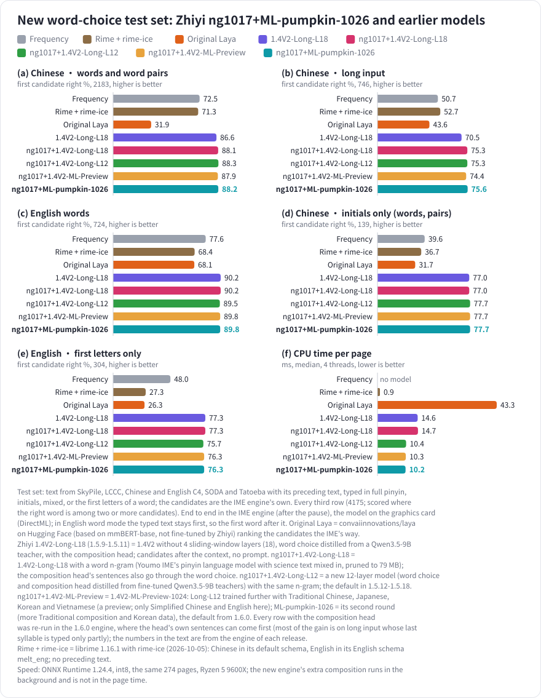
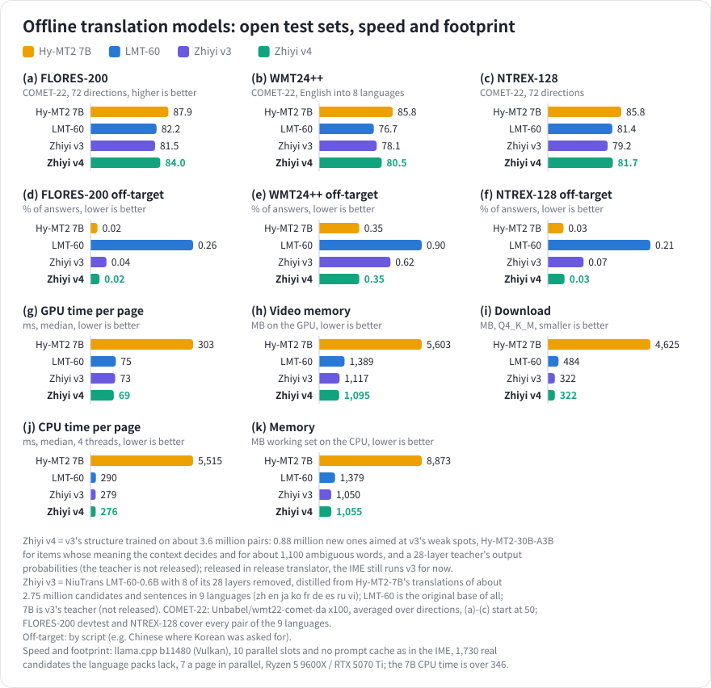

# Zhiyi IME (知意输入法)

**English** | [中文](README.md)

> Lightweight · Open source · Context-aware — a Windows Chinese/English input method that picks
> candidates by the text before the caret

<a href="docs/media/zhiyi-intro.mp4">▶ Watch the intro video: four people, four stories (1:58 · Chinese voices · Chinese and English subtitles)</a>

## Features

- **Context-aware recommendation**: a small model running on your computer reads the text before
  the caret, puts the most likely candidate first and marks it with a blue-purple star (权利 / 权力 /
  全力). The model works offline; nothing you type leaves your computer. With a dedicated graphics
  card the model can run on it instead (DirectML: NVIDIA, AMD and Intel cards; Settings tests the
  speed first and uses the card only when it is faster than the CPU).
- **Learning mode (candidate translations)**: each candidate shows what it means in another language,
  with English part-of-speech labels (n. v. adj. …) and up to three common senses, so you pick up a
  language while typing. Chinese candidates can be shown in English, Japanese, Korean, French,
  German, Spanish or Russian, English candidates in Chinese, Japanese, Korean, French, German, Spanish
  or Russian; words with several readings are translated by reading. Translations come from offline
  language packs (about 40,000 Chinese and 20,000 English words) looked up on your computer. The
  installer includes Chinese → English and English → Chinese; the others are downloaded on the
  Learning page in Settings. The word lists are open at
  [zhiyi-glossary](https://github.com/dd1000001000/zhiyi-glossary): corrections welcome. Phrases,
  rare words and short sentences the packs lack can be translated by a downloadable on-device model
  (about 0.3 GB, distilled from Tencent Hy-MT2-7B) on a graphics card or the CPU (about 0.3 s a page
  on the CPU): a page at once, filled in as it arrives, offline. While typing, hold Ctrl and press
  1-9 to type that candidate's translation (its first sense) instead of the candidate: `xianzai`
  then Ctrl+1 types `now`; a candidate without a translation types nothing.
- **Choose where data lives**: the user dictionary, learning records, language packs, model caches
  and downloaded models can move to another drive with one click on the General page.
- **Full pinyin, initials, Wubi, shuangpin**: full pinyin also accepts initials and a mix of both
  (`wsyige` → 我是一个); in initials mode each letter is one character (`zgr` → 中国人); shuangpin
  comes in the Microsoft, Xiaohe, Ziranma, Sogou and Smart ABC schemes and shares the dictionary
  and learning records with full pinyin. While typing, the style switch key (Ctrl+Space by default) cycles the
  four; the input box always shows the keys as typed.
- **Fuzzy pinyin**: z=zh, c=ch, s=sh, n=l, an=ang, en=eng, in=ing, each pair on or off; words found
  through a fuzzy pair show their correct pinyin.
- **English input**: word completion or letter by letter; misspelled words get their correct spelling
  as a candidate, never replaced automatically.
- **Mixed input**: a complete English word typed in Chinese mode is offered among the candidates.
- **Your own switch keys** for Chinese/English, input style, punctuation and full/half width, with
  warnings about conflicts with Windows or other programs.
- **Taskbar menu**: right-click the 中/英 indicator to switch Chinese/English, full pinyin / initials /
  Wubi / shuangpin, punctuation, full width and more, or to exit the background service (it starts again when you
  switch to Zhiyi IME).
- **Candidate window**: vertical (default) or horizontal, light and dark themes, three font sizes;
  Chinese and English interface.
- **Self-learning**: words you use move up; Backspace right after a commit undoes what it learned.
- **Backup and transfer**: export all settings, the lexicon and the learning records to one file and
  import it on another computer or after reinstalling; nothing is imported from an incomplete or
  damaged backup.
- **Optional start at sign-in**: the background service can start the first time you switch to
  Zhiyi IME instead.
- **Automatic updates**: Settings checks for a new version when it opens and installs it in one click;
  language packs have their own update check.
- **Privacy**: an optional user experience program, off by default, with records kept on your computer
  only; see the [privacy notes](docs/privacy.en.md).

## New word-choice test set and Zhiyi 1.4V2-Long-L12

The new word-choice test set is closer to real typing: text from SkyPile, LCCC dialogues, Chinese and English C4, SODA dialogues and Tatoeba, with its preceding text, typed in full pinyin, initials, full pinyin mixed with initials, or the first letters of an English word; the candidates are the IME engine's own. The default model of 1.5.9-1.5.11, Zhiyi 1.4V2-Long-L18 ([release model-zhen-long-l18](https://github.com/dd1000001000/zhiyi_ime/releases/tag/model-zhen-long-l18), GPL-3.0-only), is 1.4V2 with 4 of its sliding-window attention layers removed (22 → 18), its word choice distilled on about 1.7M such rows from a fine-tuned Qwen3.5-9B teacher (Apache-2.0): the candidates come after the context, with no prompt, each written once, so a page has about 40% fewer tokens to compute; the composition head is 1.4V2's, trained on with the encoder. End to end in the IME engine (after the pause) it puts the right word first more often than 1.4V2 and 1.5.4: Chinese words and word pairs 86.2% (1.4V2 / 1.5.4 both 84.4%), long input 67.2% (66.2% / 66.5%), English 90.2% (87.7%), initials only 77.7% (69.8% / 71.9%), English first letters only 77.3% (71.4% / 71.7%); 14.6 ms a page on the CPU, about half of 1.4V2's. On the older long-input test set it is about where 1.5.4 is (full pinyin 61.8%, last syllables as initials 30.6%, abbreviated then full 16.5%), and 77.6% on the IME's real candidates (1.5.4: 78.5%). The same model with the word-choice head only is Zhiyi 1.4V2-Sim-L18 ([release model-zhen-sim-l18](https://github.com/dd1000001000/zhiyi_ime/releases/tag/model-zhen-sim-l18), with a safetensors version), for IMEs that compose long input their own way: its word choice matches Long-L18's (the last row of each panel: Chinese words and word pairs 86.3%, English 90.5%, initials only 77.0%, English first letters only 78.0%, 12.1 ms a page on the CPU), but in Zhiyi long input is then composed without the model (long input 62.2%).

ng1017+1.4V2-Long-L18 adds a word n-gram (a trigram language model) to 1.4V2-Long-L18. Its base is the pinyin language model of [Youmo IME](https://github.com/Sraw/youmo-ime) ([libime](https://github.com/fcitx/libime)'s model mixed with conversational pages of FineWeb-2 and Common Crawl); with Youmo's tool about 100 million characters of science text were mixed in ([CSL](https://github.com/ydli-ai/CSL) paper abstracts and the science and technology pages of SkyPile, C4 and FineWeb-2), and it was pruned by relative entropy to 4 million bigrams and 4 million trigrams (79 MB). Each whole-input candidate's score gains the n-gram's ln P (its weight tuned on the dev set), and the word choice now runs with nothing before the caret too; the sentences the composition head writes also go through the word choice (before, its first sentence simply went first). End to end in the IME engine: Chinese words and word pairs 86.2% → 87.6%, long input 67.2% → 74.5%, English, initials only and English first letters unchanged; on the older long-input test set, full pinyin 61.8% → 69.0%, the last syllable as its initial 30.6% → 36.6%, initials then full pinyin 16.5% → 21.9%. The cost: on the CPU a page with nothing before the caret now runs the model (median about 2 → 11 ms), a long-input page runs the word choice once more (about +10 ms), and the n-gram file is 79 MB (mapped, not read into memory).

Zhiyi 1.4V2-Long-L12 ([release model-zhen-long-l12](https://github.com/dd1000001000/zhiyi_ime/releases/tag/model-zhen-long-l12), Apache-2.0, with a safetensors version), the default model from 1.5.12, is a new model that keeps 12 of 1.4V2's 22 encoder layers. Its word choice is distilled from a fine-tuned Qwen3.5-9B teacher on about 3.77M rows: besides 1.4V2-Long-L18's 1.7M, about 1.72M more of SkyPile, LCCC, C4 and SODA text and about 0.35M rows of recent web pages from [FineWeb](https://huggingface.co/datasets/HuggingFaceFW/fineweb) and [FineWeb-2](https://huggingface.co/datasets/HuggingFaceFW/fineweb-2) (ODC-By 1.0), Chinese and English about 3:1. Its composition head is distilled from a second fine-tuned Qwen3.5-9B teacher that writes the typed characters, on about 4.31M composition rows, 2.2M of them scored by the teacher. With ng1017, end to end in the IME engine (the last row of each panel), it ties ng1017+1.4V2-Long-L18: Chinese words and word pairs 87.7% (87.6%), long input 74.9% (74.5%), English 89.5% (90.2%), initials only 76.3% (77.7%), English first letters only 75.7% (77.3%), all within sampling error; 10.4 ms a page on the CPU (14.7 ms), about 30% faster, and an 84 MB model file (96 MB). Zhiyi IME ships ng1017+1.4V2-Long-L12 from 1.5.12.

## Offline translation model

Candidates the learning-mode language packs lack are translated by a model on your computer, now Zhiyi v3: [LMT-60-0.6B](https://huggingface.co/NiuTrans/LMT-60-0.6B) with 8 of its 28 layers removed, distilled from Tencent [Hy-MT2-7B](https://huggingface.co/tencent/Hy-MT2-7B)'s translations of about 2.75 million IME candidates and sentences (in 9 languages: Chinese, English, Japanese, Korean, French, German, Spanish, Russian and Vietnamese, with the text before the caret). On three open test sets its COMET-22 is 8-11 points above Zhiyi v2 used before and close to the original LMT-60 (1-2 points lower on FLORES-200 and NTREX-128, 1.4 higher on WMT24++); answers not in the target language fall from about 6% with v2 to under 0.1% on FLORES-200 and NTREX-128. The download is about 0.32 GB (v2: about 0.4 GB), a page takes about 70 ms on the graphics card and about 0.3 s on the CPU, both faster than v2, with less video memory and memory.

## Installation

**Requirements**: Windows 10 / 11 (64-bit).

1. Download the latest `zhiyi-v<version>-setup.exe` from
   [Releases](https://github.com/dd1000001000/zhiyi_ime/releases/latest) and run it (administrator
   approval is needed).
2. Press `Win + Space` to switch to Zhiyi IME, or make it the default input method in Windows Settings
   > Time & language > Language & region.
3. To open Settings, right-click 中/英 on the taskbar and choose Settings….

- **Updates**: when a new version is out, Settings tells you; click Update now on its Updates page.
  Programs already open use the new version after they are reopened.
- **Moving to another computer or reinstalling**: Export… on the Dictionary page of Settings, then
  Import… on the new computer.
- **Uninstalling**: uninstall Zhiyi IME in Windows Settings > Apps > Installed apps; you can keep your
  personal data (settings, learned words and downloaded language packs in `%USERPROFILE%\zhiyi\`).

## Credits

Zhiyi IME is a modified version of [CxxIME](https://github.com/deanxyuan/cxx-ime). Thanks to:

- [CxxIME](https://github.com/deanxyuan/cxx-ime): the input method framework, pinyin engine,
  candidate window and settings app (Apache License 2.0)
- [rime-ice](https://github.com/iDvel/rime-ice): the Chinese pinyin dictionary and English word list (GPL-3.0)
- [Laya](https://huggingface.co/convaiinnovations/laya): the recommendation model's architecture and the teacher it was distilled from (Apache-2.0)
- [mmBERT](https://huggingface.co/jhu-clsp/mmBERT-small): the recommendation model's encoder, mmBERT-small (MIT)
- [LMT-60](https://huggingface.co/NiuTrans/LMT-60-0.6B) (NiuTrans): the base of the offline translation model (Apache-2.0)
- [Hy-MT2](https://huggingface.co/tencent/Hy-MT2-7B) (Tencent Hunyuan): the first offline translation model (1.8B) and the teacher it was distilled from (7B) (Apache-2.0)
- [Qwen3.5-9B](https://huggingface.co/Qwen/Qwen3.5-9B) (Qwen): the teachers Zhiyi 1.4V2-Long-L18's, Sim-L18's and Long-L12's word choice and Long-L12's composition head were distilled from, fine-tuned with LoRA (Apache-2.0)
- [Youmo IME](https://github.com/Sraw/youmo-ime): the base of the word n-gram (its pinyin language model) and the tool that mixed it (LGPL-2.1-or-later); that base comes from [libime](https://github.com/fcitx/libime) (LGPL-2.1-or-later) and pages of [FineWeb-2](https://huggingface.co/datasets/HuggingFaceFW/fineweb-2) (ODC-By) and [Common Crawl](https://commoncrawl.org)
- [CSL](https://github.com/ydli-ai/CSL) (Chinese Scientific Literature, Apache-2.0): the science text mixed into the word n-gram
- [llama.cpp](https://github.com/ggml-org/llama.cpp): the offline translation runtime (MIT, downloaded with the model)
- [LCCC](https://github.com/thu-coai/CDial-GPT) (MIT) and the Chinese part of [C4](https://huggingface.co/datasets/allenai/c4) (ODC-BY): part of the distillation text
- [Tatoeba](https://tatoeba.org) (CC BY 2.0 FR) and the English, Japanese, Korean, French, German, Spanish, Russian and Vietnamese parts of [C4](https://huggingface.co/datasets/allenai/c4) (ODC-BY): the foreign-language source texts of offline translation model v3
- [SkyPile-150B](https://huggingface.co/datasets/Skywork/SkyPile-150B) (Skywork, Skywork Community License): about 70% of the training text for long-pinyin composition since 1.5.4, the Chinese sentences of offline translation model v3, and part of 1.4V2-Long-L18's, Sim-L18's and Long-L12's word-choice data and of Long-L12's composition data
- [SODA](https://huggingface.co/datasets/allenai/soda) (CC BY 4.0), Tatoeba and the English part of C4: the text of 1.4V2-Long-L18's, Sim-L18's and Long-L12's English word-choice data
- [FineWeb](https://huggingface.co/datasets/HuggingFaceFW/fineweb) and [FineWeb-2](https://huggingface.co/datasets/HuggingFaceFW/fineweb-2) (ODC-By 1.0): the recent web pages in 1.4V2-Long-L12's word-choice data
- [wordfreq](https://github.com/rspeer/wordfreq): English word frequencies (CC BY-SA 4.0)
- [ONNX Runtime](https://github.com/microsoft/onnxruntime): model inference (MIT)
- [DirectML](https://github.com/microsoft/DirectML): inference on graphics cards (Microsoft DirectML
  license, redistributable)

The learning-mode language packs were generated offline by large language models (GLM, Gemma), then
checked automatically and corrected by hand; the word lists are open under GPL-3.0 at
[zhiyi-glossary](https://github.com/dd1000001000/zhiyi-glossary).

Zhiyi IME is licensed under [GPL-3.0-only](LICENSE). The weights of Zhiyi 1.4V2-Long-L12 (the recommendation model from 1.5.12) and offline translation model v3 are licensed under [Apache-2.0](data/licenses/Apache-2.0.txt); the other models Zhiyi trained itself (earlier recommendation models, offline translation model v2) are licensed under GPL-3.0-only; the voice models (SenseVoice-Small, Silero VAD) and the llama.cpp runtime are not Zhiyi's and keep their own licenses, which come with the download; full notices are in [NOTICE](NOTICE) and
[THIRD_PARTY_NOTICES.txt](THIRD_PARTY_NOTICES.txt). Development and build notes:
[docs/development.md](docs/development.md).
