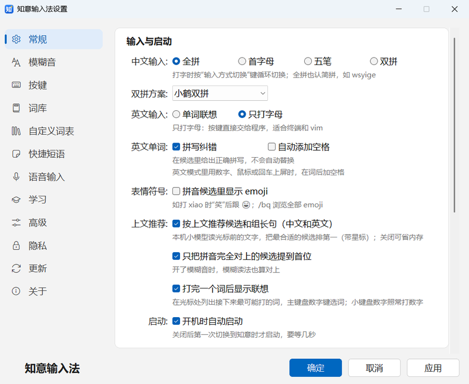
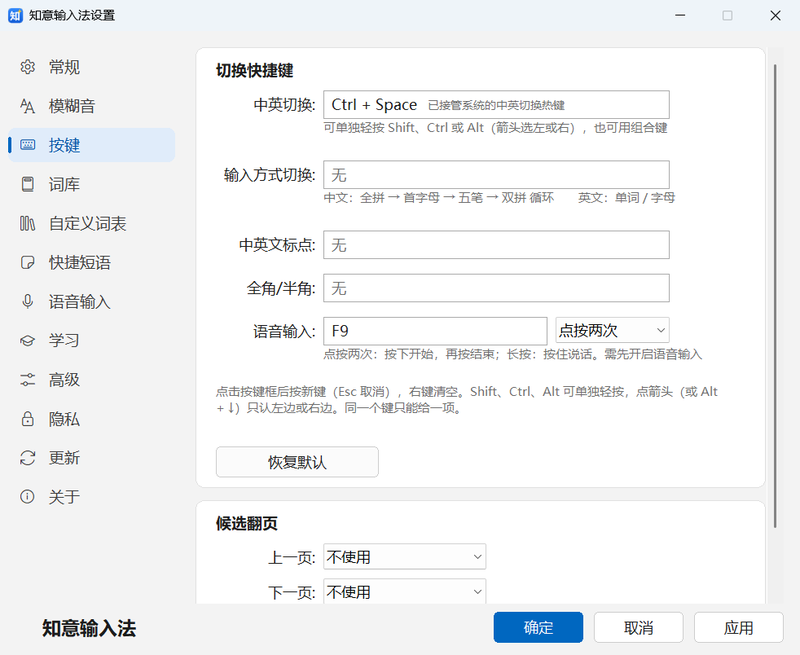
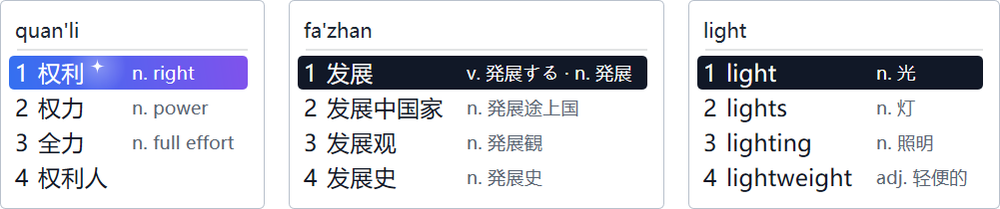
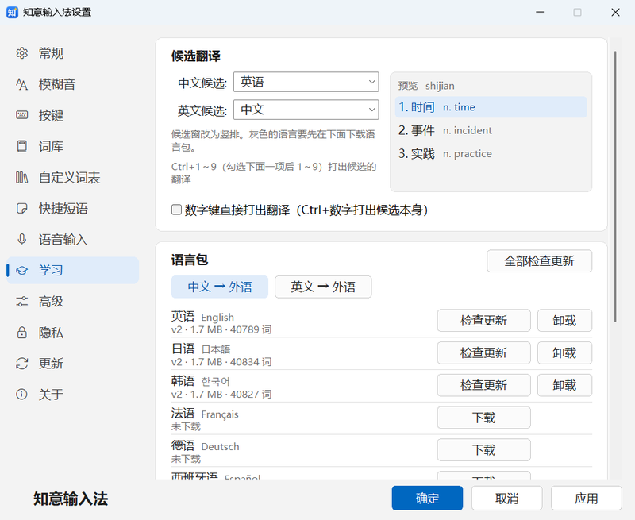
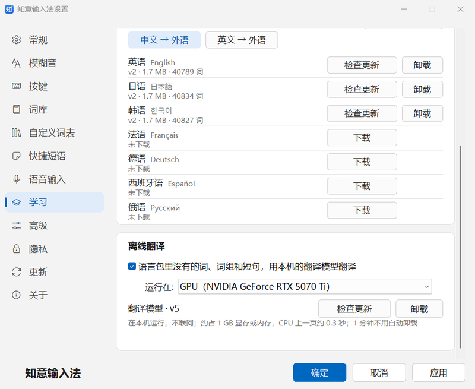
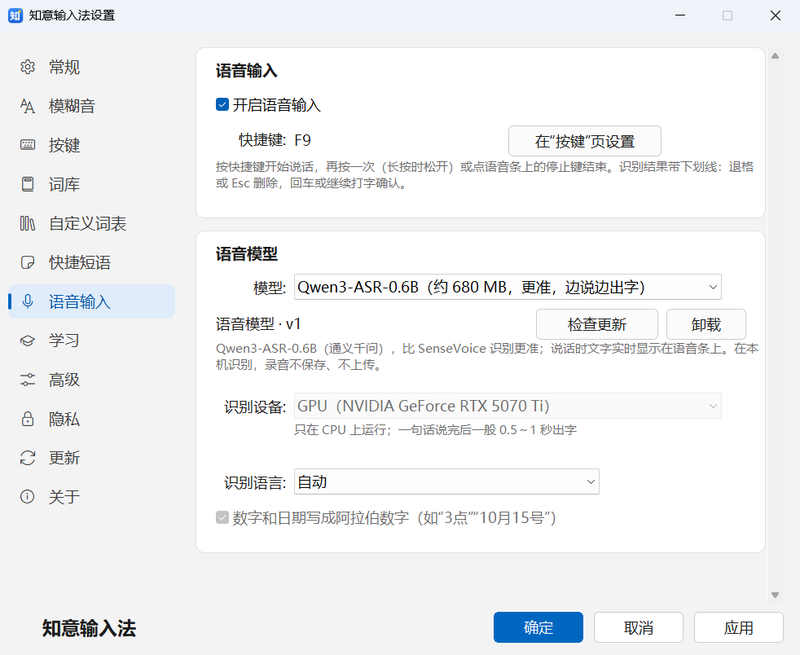
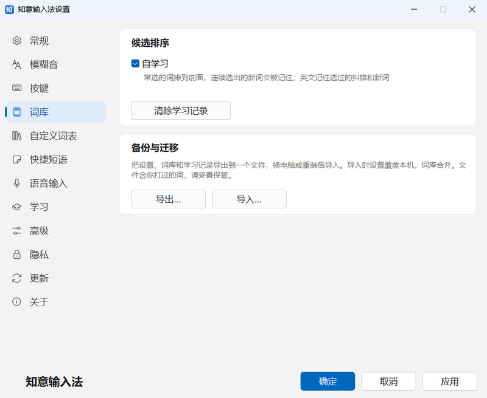
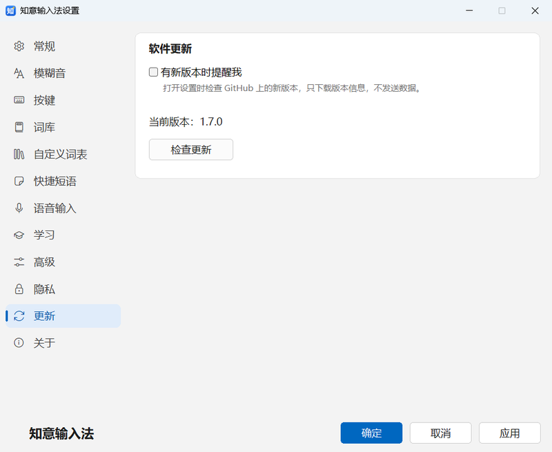

# 新手入门

这份说明写给第一次用知意输入法的人：从安装、打字，到翻译和语音这些要另外下载的功能，再到没有互联网的电脑怎么装。
每个选项的详细说明见 [设置指南](settings-guide.md)。

## 目录

1. [安装](#1-安装)
2. [切换到知意并开始打字](#2-切换到知意并开始打字)
3. [打开设置](#3-打开设置)
4. [常用设置](#4-常用设置)
5. [学习模式：候选翻译和离线翻译](#5-学习模式候选翻译和离线翻译)
6. [语音输入](#6-语音输入)
7. [没有互联网的电脑怎么用](#7-没有互联网的电脑怎么用)
8. [备份、更新和卸载](#8-备份更新和卸载)
9. [常见问题](#9-常见问题)

## 1. 安装

**系统要求**：Windows 10 / 11，64 位。

1. 打开 [Releases 页面](https://github.com/dd1000001000/zhiyi_ime/releases/latest)，在页面下方的 Assets 里点
   `zhiyi-v版本号-setup.exe` 下载（不要下载 `latest.json`，那是给自动更新用的）。
2. 双击安装包。Windows 问“是否允许此应用对你的设备进行更改”时点“是”（安装需要管理员权限）。
3. 按提示点“下一步”。“用户体验改进计划”可以不勾，不影响使用（见 [隐私说明](privacy.md)）。
4. 安装时如果提示有程序正在使用旧版本，按提示关掉那些程序再点“重试”。

安装包里已经带了选词模型、词典和中 ↔ 英语言包，**装好就能打字，不需要联网**。翻译模型、语音模型和其他语言的语言包
要在设置里另外下载（见第 5、6 节；没有互联网时见第 7 节）。

## 2. 切换到知意并开始打字

- 按 **Win + 空格**（按住 Windows 徽标键再按空格）切换输入法，直到任务栏右下角出现“中”或“英”。
- 想让它成为默认输入法：Windows“设置 > 时间和语言 > 语言和区域”，在“中文（简体，中国）”的“语言选项”里调整键盘顺序，
  或删掉不用的输入法。
- 如果列表里没有知意输入法，注销后重新登录一次。

**打字的基本操作**（默认设置）：

| 想做的事 | 怎么按 |
| --- | --- |
| 中文 / 英文切换 | 轻按一下 **Shift**；或左键点任务栏上的“中/英” |
| 打出第一个候选 | **空格** |
| 打出第 2～9 个候选 | 按候选前面的数字，或用鼠标点 |
| 翻页 | **PageUp / PageDown**，或 ↑ ↓ 移动 |
| 打出拼音字母本身 | **回车** |
| 取消正在打的拼音 | **Esc** |
| 全拼 → 首字母 → 五笔 → 双拼 | **Ctrl + 空格** 循环切换 |
| 中文标点 / 英文标点 | **Ctrl + .** |
| 全角 / 半角 | **Shift + 空格** |

- 全拼也认简拼和混拼：`wsyige` → 我是一个，`zgr` → 中国人。
- 候选里带蓝紫色星标的，是模型根据光标前的文字推荐的词，通常就是你想打的。
- 选过的词会自动往前排；选错了，刚上屏就按退格，可以撤销这次学习。
- 打完一个词后，光标处会列出接下来可能要打的词（联想），按主键盘数字键选，按别的键就关掉；小键盘数字照常打数字。

上面的快捷键都能在设置的“按键”页改（见第 4 节）。

## 3. 打开设置

两种方法：

- **右键**任务栏右下角的“中/英”，选“设置…”；
- 或者在开始菜单里找“知意输入法设置”。

设置窗口左边是各页，右下角三个按钮：**确定**（保存并关闭）、**取消**（不保存）、**应用**（保存，不关窗口）。
改了设置一定要点“确定”或“应用”才会生效。

右键任务栏的“中/英”还能直接切换全拼 / 五笔 / 双拼、标点、全角，以及“退出”后台（再切到知意时会自动重新启动）。

## 4. 常用设置

**常规页**（上图）：

- **中文输入**：全拼、首字母、五笔或双拼。用双拼的在下面选方案（微软、小鹤、自然码、搜狗、智能ABC）。
- **英文输入**：“单词联想”打几个字母就给出整个单词；“只打字母”就是普通的英文键盘，适合写代码。
- **上文推荐**：根据光标前的文字把最合适的词排第一，建议保持勾选；电脑内存很小时可以关掉省内存。
- **开机时自动启动**：关掉后开机不启动后台，第一次切到知意时才启动，要等几秒。
- 往下滚动还有主题（浅色 / 深色）、字号、候选横排 / 竖排、数据位置等。

**模糊音页**：分不清 z/zh、n/l、en/eng 的，在这里勾上对应的组。

**按键页**：改中英切换、输入方式切换、标点、全角、语音输入这五个快捷键。点一下按键框，再按你想用的键；
右键点按键框是清空（不用这个快捷键）。“恢复默认”回到第 2 节表里的默认键。

**自定义词表页**：导入搜狗细胞词库（`.scel`）、Rime 词库或文本词库，专业词汇、地名等就会出现在候选里。

**快捷短语页**：设一个编码打出一段固定的文字，比如打 `dh` 出手机号，见 [快捷短语](custom-phrases.md)。

## 5. 学习模式：候选翻译和离线翻译

学习模式在每个候选后面显示它的外语意思，打字时顺便学外语。还可以按住 **Ctrl** 再按数字，直接打出那个候选的翻译
（如 `xianzai` 按 Ctrl+1 打出 `now`）。

**打开方法**：设置 >“学习”页。

1. 在“中文候选”里选一种外语（如英语），“英文候选”里选一种（如中文）。灰色的语言要先在下面的“语言包”里点“下载”
   （中 → 英、英 → 中装好就有，不用下载）。
2. 点“确定”。候选窗口会自动改成竖排，翻译只在竖排时显示。

**离线翻译**（可选）：语言包是一张词表，里面没有的词组、生僻词和短句不显示翻译。想让它们也有翻译：

1. 在“学习”页往下滚，找到“离线翻译”，点“下载”（翻译模型约 400 MB）。
2. 下载完勾选“语言包里没有的词、词组和短句，用本机的翻译模型翻译”。
3. “运行在”：有 NVIDIA / AMD 独立显卡选显卡更快；没有就选 CPU（一页约 0.3 秒，也够用）。
4. 点“确定”。

翻译模型在本机运行，不联网；1 分钟不用会自动卸载，不长期占内存。详见 [学习模式](learning-mode.md)。

## 6. 语音输入

按一个快捷键说话，说完自动转成文字放进输入框，全程在本机识别，录音不保存、不上传。需要麦克风。

1. 设置 >“语音输入”页，在“模型”里选一个并点“下载”：
   - **SenseVoice-Small**（约 240 MB）：说完后整段识别，快；
   - **Qwen3-ASR-0.6B**（约 680 MB）：更准，说话时文字实时显示，说完后约 0.5～1 秒出字。
2. 下载完会自动勾上“开启语音输入”。
3. 点“在‘按键’页设置”，给“语音输入”设一个快捷键（**默认没有**，必须设），比如 F9。
4. 点“确定”。

**使用**：在要输入文字的地方按一下快捷键，屏幕下方出现语音条，开始说话；说完再按一下快捷键（或停顿 2 秒自动结束）。
识别出的文字带下划线：按 **回车** 或接着打字就是确认，按 **退格** 或 **Esc** 整段删掉。详见 [语音输入](voice-input.md)。

## 7. 没有互联网的电脑怎么用

安装和打字都不需要联网。翻译模型、语音模型和其他语言的语言包，需要先在一台**能上网的 Windows 电脑**上下载，
再用 U 盘或移动硬盘拷过去。

**第一步：在能上网的电脑上**

1. 安装和要用的那台电脑**同一版本**的知意（同一个安装包，可以一起拷过去）。
2. 打开设置，按第 5、6 节下载要用的东西：“学习”页的语言包和离线翻译模型，“语音输入”页的语音模型。

**第二步：拷出这些文件夹**

在资源管理器的地址栏里粘贴下面的路径，回车就能打开：

| 文件夹 | 里面是什么 |
| --- | --- |
| `%LOCALAPPDATA%\zhiyi\translator` | 离线翻译模型（约 400 MB） |
| `%LOCALAPPDATA%\zhiyi\voice` | 语音模型 SenseVoice（下载了才有） |
| `%LOCALAPPDATA%\zhiyi\voice-qwen3-asr` | 语音模型 Qwen3-ASR（下载了才有） |
| `%USERPROFILE%\zhiyi\glossary` | 学习模式的语言包 |

把这几个文件夹整个复制到 U 盘（复制文件夹本身，不要只复制里面的文件）。

**第三步：在没有网的电脑上**

1. 用同一个安装包安装知意。
2. 把 `translator`、`voice`、`voice-qwen3-asr` 三个文件夹复制到 `%LOCALAPPDATA%\zhiyi\` 里，
   `glossary` 复制到 `%USERPROFILE%\zhiyi\` 里。提示文件夹已存在时选“替换”。
3. 打开设置，“学习”页和“语音输入”页会显示“已安装”，按第 5、6 节勾选开启，点“确定”。

**注意**

- 如果在“常规”页改过“数据位置”（比如放到 D 盘），上面的 `%LOCALAPPDATA%\zhiyi\` 要换成 `<所选文件夹>\zhiyi\local\`，
  `%USERPROFILE%\zhiyi\` 要换成 `<所选文件夹>\zhiyi\`。“常规”页的“数据位置”一行会显示当前用的文件夹。
- 没有网时，设置里的“检查更新”会提示连不上，不影响使用。可以在“更新”页取消勾选“有新版本时提醒我”。
- 以后升级：在能上网的电脑上下载新版安装包，拷过去安装就行，模型文件夹不用重拷（除非新版的说明里写了要新模型）。

## 8. 备份、更新和卸载

**备份与换电脑**：设置 >“词库”页 >“导出…”，把设置、自己的词和学习记录存成一个文件；到新电脑上装好知意后“导入…”。

**更新**：“更新”页的“有新版本时提醒我”默认勾选，打开设置时会提示新版本，点“立即更新”即可；也可以随时点“检查更新”。
更新后，已经打开的程序要关掉重开才会用上新版本。

**卸载**：Windows“设置 > 应用 > 已安装的应用”，找到“知意输入法”点卸载。卸载时可以选是否删除个人数据
（设置、词库和学习记录）；不删的话，以后重装还能接着用。

## 9. 常见问题

**按 Shift 没反应 / 打不出中文？**
先看任务栏右下角是不是“中”或“英”。如果是别的输入法，按 Win + 空格切过来。是“英”时轻按一下 Shift。

**切换输入法的列表里没有知意？**
注销后重新登录。还没有的话，重新运行一次安装包。

**某个程序里打字没反应，别的程序正常？**
把那个程序关掉重开（刚安装或刚更新时，已经打开的程序还在用旧的输入法）。

**看不到翻译？**
翻译只在竖排时显示：“常规”页的“候选排列”选竖排。再确认“学习”页选了翻译语言，并点了“确定”。

**语音输入按了快捷键没反应？**
确认“语音输入”页勾选了“开启语音输入”，并在“按键”页给“语音输入”设了快捷键。另外检查 Windows 是否允许桌面应用
使用麦克风（Windows“设置 > 隐私和安全性 > 麦克风”）。

**有问题怎么反馈？**
到 [Issues](https://github.com/dd1000001000/zhiyi_ime/issues) 提问，写清 Windows 版本、知意版本（“关于”页）
和出问题的程序；能附上截图更好。
